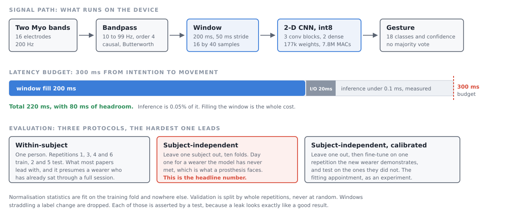
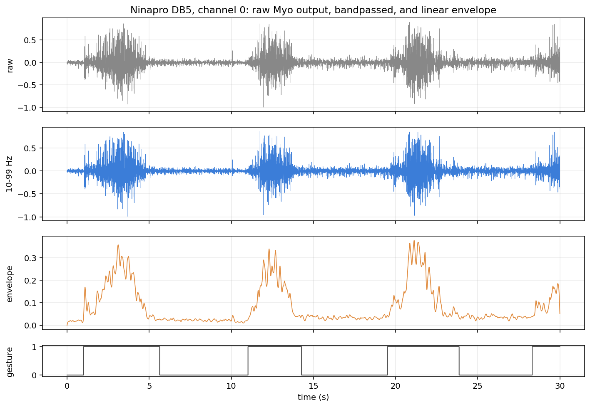
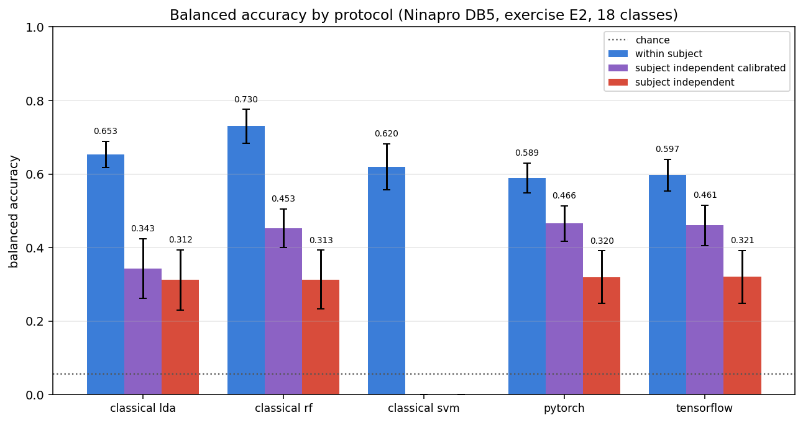
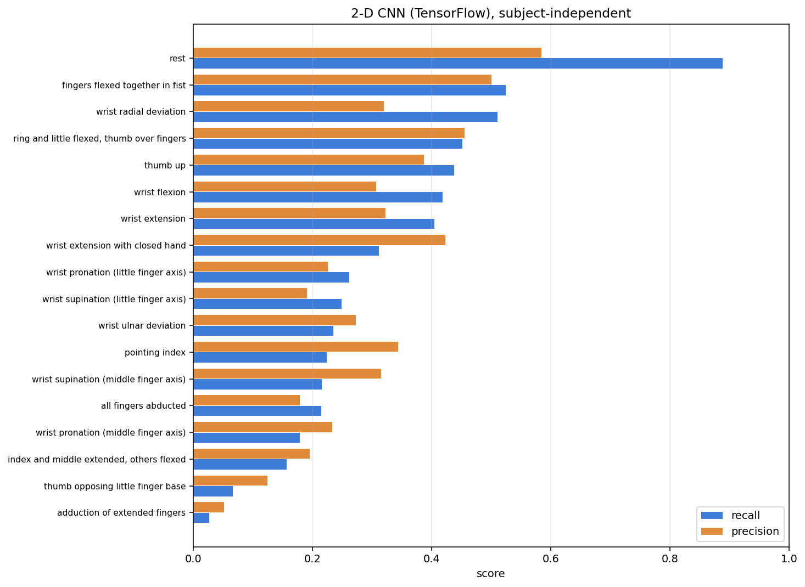
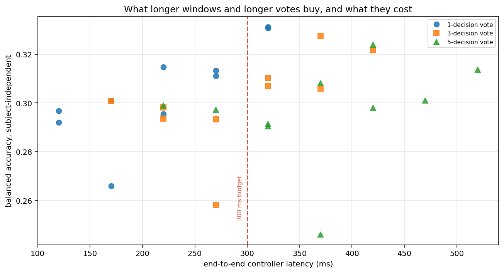

# ml-semg-gesture-classifier

Real-time hand gesture classification from surface electromyography, for
prosthetic control. Public Ninapro DB5 data, the full path from raw signal to
a quantised model that runs inside a stated control-loop deadline, and a
subject-independent evaluation that says what the thing would actually do on
somebody new.





*Ninapro DB5, subject 1, one Myo electrode. Three contractions, thirty
seconds. The top trace is what the armband emits, the middle is after the
10-99 Hz bandpass, the bottom is the linear envelope, and the step plot is the
label. Regenerate it with `make figures`.*

---

## The claim this repository is built around

**Within-subject sEMG accuracy is easy and close to useless.**

Train on somebody's recordings, test on more of their recordings, and the
numbers look good. A prosthesis is fitted to a person the model has never met.
The number that matters is what happens then, and it is much worse. The
within-subject figure is the one the Ninapro literature usually leads with,
and it describes a device that has already met its user.

This repository reports both, leads with the hard one, and states the gap:

<!-- BEGIN:gap -->
| Model | Within-subject | Subject-independent | Gap | Relative drop | + calibration | Gap recovered |
| --- | --- | --- | --- | --- | --- | --- |
| LDA on time-domain features | 0.653 | 0.312 | 0.341 | 52.2% | 0.343 | 9% |
| Random forest on time-domain features | 0.730 | 0.313 | 0.417 | 57.1% | 0.453 | 33% |
| 2-D CNN (PyTorch) | 0.589 | 0.320 | 0.270 | 45.8% | 0.466 | 54% |
| 2-D CNN (TensorFlow) | 0.597 | 0.321 | 0.276 | 46.3% | 0.461 | 51% |
<!-- END:gap -->

Read the `Subject-independent` column. That is the day-one performance of a
device fitted to wearer eleven, and it is roughly **half** the within-subject
figure for every model here. Note also that all four models land within 0.01
of each other in that column, against a between-subject standard deviation of
0.08: on the hard problem, nothing in this repository is meaningfully better
than anything else in it.

The `+ calibration` column is what a few minutes of fitting-appointment data
buys back, and it is where the models stop being interchangeable. The
networks recover about half the gap; the linear discriminant recovers
almost none of it.

Full protocol definitions and the leakage rules that keep these honest:
[`docs/EVALUATION_PROTOCOL.md`](docs/EVALUATION_PROTOCOL.md).

---

## Quick start

```bash
git clone https://github.com/CGainsWorks/ml-semg-gesture-classifier.git
cd ml-semg-gesture-classifier
bash scripts/setup.sh
```

Then one command:

```bash
bash scripts/run_demo.sh
```

If Ninapro DB5 is already on disk it reproduces every number on this page,
which takes a few hours. If it is not, it runs the same pipeline end to end on
synthetic data in about two minutes and tells you how to get the real thing.
Add `--data` to download DB5 (about 200 MB) and then run the real one.

The synthetic path trains both frameworks, quantises to TFLite int8 and ONNX
int8, runs the embedded runtimes, benchmarks latency and streams a recording
through the controller. **The accuracy it prints is a wiring check, not a
result**, and it says so on every run and in every file it writes.

`make smoke`, `make demo` and `docker compose run --rm demo` are the same
three things through the Makefile and a container.

---

## The data

<!-- BEGIN:dataset -->
| Property | Value |
| --- | --- |
| Dataset | Ninapro DB5, exercise E2 |
| Sensor | two Thalmic Myo armbands, 16 dry electrodes |
| Sampling | 16 channels at 200 Hz |
| Subjects | 10 intact-limbed adults (2 f, 8 m) |
| Ages | 22 to 34 |
| Forearm circumference | 22 to 28.5 cm |
| Recording | 2.81 hours |
| Classes | 18 (rest plus 17 movements) |
| Window | 40 samples (200 ms), 50 ms stride |
| Windows after rest balancing | 74,764 |
| Windows per class | 3,395 to 4,833 |
<!-- END:dataset -->

Ninapro DB5 is two Thalmic Myo armbands: consumer-grade, dry-electrode,
wireless. It was chosen over the more commonly used DB2 because the sensor is
the kind a real prosthesis would carry rather than a laboratory amplifier that
costs more than the arm. The trade-off is a 200 Hz sample rate, which caps the
usable band at 100 Hz and puts DB5 accuracies below DB2 accuracies on the same
movements. Numbers here are not comparable to DB2 results and are not intended
to be.

The data is downloaded, checksummed and left sealed in its archives. Nothing
is redistributed here. It carries a **research-use licence**; read
[`data/DATASET_CARD.md`](data/DATASET_CARD.md) before using it for anything,
and read the publisher's terms before using it commercially.

The dataset card also documents two distribution quirks that will otherwise
cost you an afternoon: the `exercise` field inside a DB5 `.mat` file does not
match the exercise the file contains, and `rerepetition` is zero throughout
every rest period, so rest belongs to no repetition until something assigns it
one.

---

## Results

All ten subjects, exercise B, 18 classes including rest. Pooled by summing
per-fold confusion matrices; the per-fold spread is reported separately
because for the subject-independent protocol the variation between subjects is
as informative as the mean.

<!-- BEGIN:accuracy -->
| Protocol | Model | Accuracy | Balanced accuracy | Macro F1 | Per-fold mean ± sd | Worst / best fold |
| --- | --- | --- | --- | --- | --- | --- |
| Within-subject | LDA on time-domain features | 0.652 | 0.653 | 0.660 | 0.653 ± 0.036 | 0.583 / 0.709 |
| Within-subject | RBF SVM on time-domain features | 0.619 | 0.620 | 0.619 | 0.622 ± 0.062 | 0.530 / 0.710 |
| Within-subject | Random forest on time-domain features | 0.729 | 0.730 | 0.731 | 0.730 ± 0.046 | 0.629 / 0.793 |
| Within-subject | 2-D CNN (TensorFlow) | 0.596 | 0.597 | 0.597 | 0.597 ± 0.043 | 0.538 / 0.670 |
| Within-subject | 2-D CNN (PyTorch) | 0.587 | 0.589 | 0.589 | 0.588 ± 0.041 | 0.518 / 0.650 |
| Subject-independent (LOSO) | LDA on time-domain features | 0.314 | 0.312 | 0.312 | 0.316 ± 0.082 | 0.167 / 0.440 |
| Subject-independent (LOSO) | Random forest on time-domain features | 0.312 | 0.313 | 0.301 | 0.315 ± 0.080 | 0.192 / 0.427 |
| Subject-independent (LOSO) | 2-D CNN (TensorFlow) | 0.318 | 0.321 | 0.304 | 0.320 ± 0.072 | 0.199 / 0.432 |
| Subject-independent (LOSO) | 2-D CNN (PyTorch) | 0.317 | 0.320 | 0.308 | 0.319 ± 0.072 | 0.217 / 0.443 |
| Subject-independent + calibration | LDA on time-domain features | 0.344 | 0.343 | 0.346 | 0.346 ± 0.081 | 0.223 / 0.484 |
| Subject-independent + calibration | Random forest on time-domain features | 0.452 | 0.453 | 0.448 | 0.453 ± 0.053 | 0.365 / 0.559 |
| Subject-independent + calibration | 2-D CNN (TensorFlow) | 0.459 | 0.461 | 0.454 | 0.462 ± 0.055 | 0.343 / 0.536 |
| Subject-independent + calibration | 2-D CNN (PyTorch) | 0.465 | 0.466 | 0.461 | 0.467 ± 0.048 | 0.388 / 0.537 |
<!-- END:accuracy -->



### Per class

<!-- BEGIN:per_class -->
Model: 2-D CNN (TensorFlow), Subject-independent (LOSO). This is whichever
model came out with the best subject-independent balanced accuracy.

|  | Code | Gesture | Precision | Recall | F1 |
| --- | --- | --- | --- | --- | --- |
| worst | 8 | adduction of extended fingers | 0.051 | 0.027 | 0.035 |
| worst | 4 | thumb opposing little finger base | 0.125 | 0.066 | 0.087 |
| worst | 2 | index and middle extended, others flexed | 0.195 | 0.156 | 0.173 |
| worst | 10 | wrist pronation (middle finger axis) | 0.233 | 0.178 | 0.202 |
| worst | 5 | all fingers abducted | 0.179 | 0.215 | 0.195 |
| best | 1 | thumb up | 0.387 | 0.437 | 0.411 |
| best | 3 | ring and little flexed, thumb over fingers | 0.455 | 0.451 | 0.453 |
| best | 15 | wrist radial deviation | 0.320 | 0.510 | 0.393 |
| best | 6 | fingers flexed together in fist | 0.500 | 0.524 | 0.512 |
| best | 0 | rest | 0.584 | 0.888 | 0.705 |


<!-- END:per_class -->

The pattern in that table is not random and it is the useful part. What
survives the transfer to a new wearer is **gross, whole-hand posture**: rest,
a closed fist, a thumb up, wrist deviation. What does not survive is **fine
finger configuration**: adduction of extended fingers, thumb-to-little-finger
opposition, individual finger extension. Those need the small forearm muscles
whose signal is weakest at the skin and whose position relative to a
dry-electrode armband varies most between people.

The confusion matrices show the same thing structurally: the largest
off-diagonal masses are between the two supination variants and between the
two pronation variants, which differ only in the rotation axis and produce
nearly the same muscle activity. That is a labelling distinction the sensor
cannot see, not a failure of the classifier.

For a wrist-and-grip prosthesis that is a workable message: the vocabulary a
device should offer a new wearer is the coarse one, and finger-level control
should wait for calibration. For an eighteen-class benchmark it is a
limitation, and the number reported is the eighteen-class one.

Confusion matrices for every model and protocol are in
[`analysis/db5/`](analysis/db5/), and the full per-class breakdown is in
[`analysis/db5/EVALUATION.md`](analysis/db5/EVALUATION.md).

### Two error types, not one

Accuracy treats every mistake the same. A prosthesis does not. Confusing two
similar grasps costs the wearer a retry; moving the hand when they did not ask
it to is what makes people stop wearing the device. Both rates are reported
separately in every result file as `false_activation_rate` and
`missed_activation_rate`.

---

## The model

Three `Conv2d`-BatchNorm-ReLU-MaxPool blocks over the window treated as a
16 x 40 electrode-by-time image, then two dense layers. Implemented twice,
once in each framework, from a single shared `ArchitectureSpec`, with tests
asserting the two agree on parameter count and input shape.

The obvious design is a 1-D convolution along time with the sixteen electrodes
as input channels. That was built first and it is worse, because the
electrodes are not an unordered feature vector: they are two rings of eight
around the forearm, and adjacent electrodes see overlapping muscles. Making
them adjacent to the model as well is the difference:

<!-- BEGIN:architecture -->
| Variant | Within-subject | Subject-independent | Parameters |
| --- | --- | --- | --- |
| 1-D convolution over time | 0.537 | 0.284 | 77,170 |
| 2-D over electrodes and time (shipped) | 0.597 | 0.261 | 177,490 |
| 2-D, electrode axis wrapped | 0.606 | 0.243 | 177,490 |
| 2-D, no augmentation | 0.641 | 0.241 | 177,490 |
| 2-D, plus random electrode rotation | 0.435 | 0.292 | 177,490 |
<!-- END:architecture -->

Read that table honestly and it says three things.

**The 2-D design wins within subject and ties across subjects.** 0.606 against
0.535 on one held-out subject's own repetitions, and 0.270 against 0.269 on a
subject the model never saw. The second pair is a tie and is reported as one.
What settles it is the overfitting gap, which the 2-D design nearly halves
(0.167 against 0.296), and the ten-fold numbers in the results table above.

**Augmentation costs within-subject accuracy and buys cross-subject
accuracy.** 0.650 without it against 0.606 with, and 0.216 without against
0.270 with. That is the trade it is supposed to make, and the
subject-independent side is the one this repository leads with.

**Rotating the electrodes is the interesting negative.** Randomly rotating
each armband's eight electrodes during training makes the model invariant to
how the band was put on. It collapses within-subject accuracy to 0.396,
because for one wearer with the band in one position, which electrode sees
which muscle *is* the signal. But on the cross-subject fold it scored 0.297,
the best number in the column, because subjects really do wear the band
differently. It was not adopted: one fold at +0.027 is inside the spread of
the ten-fold run, and a deployed system is calibrated to its wearer, at which
point the band position is fixed and a model that cannot use it is giving away
what calibration is for. That second argument has not been measured, and
measuring it is the obvious next experiment.

Reproduce with `python -m experiments.architecture_comparison`.

### The classical baseline is not a strawman, and it wins the easy problem

Hudgins-style time-domain features with a classical classifier are what most
commercial myoelectric prostheses actually run. On this dataset they do not
merely hold their own:

**Within subject, the random forest is the most accurate model in this
repository**, at 0.730 balanced accuracy against 0.597 and 0.589 for the two
networks. Linear discriminant analysis, at 0.653, also beats both. Seventeen
hand-designed features per channel, on 4,600 training windows, beat a
177,000-parameter convolutional network by fourteen points. That is not a
close call and it is not hidden in an appendix.

**Cross subject, nobody wins.** All four models sit between 0.312 and 0.321,
which against a per-fold standard deviation of about 0.08 is a four-way tie.
Whatever the networks are learning that the features are not, it does not
transfer to a new wearer either.

**The networks earn their place at the third condition.** Given one
demonstrated repetition from the new wearer, the CNNs recover 51% and 54% of
the generalisation gap. The random forest recovers 33%, and the linear
discriminant 9%. That is the argument for a network here, and it is not an
accuracy argument: it is that a network can be fine-tuned on a handful of
windows, where a forest can only be refit and a linear discriminant has too
few degrees of freedom to move. For a device that is fitted to its user rather
than shipped pre-trained, adaptability is the property that matters, and it is
the one the networks have.

The RBF SVM is trained under the within-subject protocol only. Its fit is
quadratic in the training set size and the leave-one-subject-out folds have
thirteen times as many training windows. That is not just a runtime
inconvenience: a kernel machine with tens of thousands of support vectors
would not fit on the target hardware either.

---

## Fitting it to a new wearer

Nobody ships a prosthesis with no fitting appointment. The wearer performs
each gesture once, those recordings are the demonstrations, and the model is
fine-tuned on them:

```bash
SUBJECT=3 make calibrate
```

That trains a model on the other nine subjects, measures it on subject 3,
fine-tunes it on one repetition of subject 3's gestures, and measures it again
on the repetitions it has still never seen. The ten-fold version of the same
thing is the `+ calibration` column in the gap table above.

`--holdout` is what makes the before-and-after meaningful: without it the
command loads the shipped model, which was trained on every subject including
this one, and the "before" number is optimistic. The report says which mode
produced it.

This is the part of the brief's "imitation learning and learning by
demonstration" that applies to a classifier: supervised learning from
demonstrated examples. It is not policy cloning over state-action
trajectories, because there is no arm here to imitate, and calling it that
would be relabelling rather than building it.

---

## Deployment

Both frameworks export, and both export twice: float32 to prove the conversion
changed nothing, and int8 because that is what runs on the device.

<!-- BEGIN:quantisation -->
| Artefact | Size | Accuracy | p50 latency (ms) | p99 latency (ms) |
| --- | --- | --- | --- | --- |
| `gesture_cnn_float32.onnx` | 695 KiB | 0.5526 | 0.136 | 0.240 |
| `gesture_cnn_float32.tflite` | 696 KiB | 0.5833 | 0.126 | 0.334 |
| `gesture_cnn_int8.onnx` | 190 KiB | 0.5548 | 0.116 | 0.171 |
| `gesture_cnn_int8.tflite` | 186 KiB | 0.5822 | 0.208 | 0.314 |
<!-- END:quantisation -->

The TFLite int8 model is **fully integer**: weights, activations, input and
output. The converter is configured to refuse a float fallback, because a
silent fallback produces a model that runs on a desktop and then fails to
build for TFLite Micro. CI asserts it.

Accuracy above is measured **through the deployed runtimes**, one window at a
time, on held-out repetitions, not with the training-time graph.

---

## The latency budget

A myoelectric controller has roughly **300 ms** from the wearer's intention to
the arm moving. Past that, users stop experiencing the hand as part of
themselves. The figure comes from Englehart and Hudgins (2003) and Farrell and
Weir (2007); the reasoning is in
[`docs/LATENCY_BUDGET.md`](docs/LATENCY_BUDGET.md).

**The model is not the problem.** Inference is a rounding error next to the
time the window takes to fill:

<!-- BEGIN:latency_budget -->
| Term | Milliseconds | Provenance |
| --- | --- | --- |
| Window fill | 200.0 | measured geometry |
| Majority vote | 0.0 | not used; see the geometry sweep |
| Inference (p99) | 0.319 | measured, this machine, int8 |
| Acquisition and actuation | 20.0 | **assumed**, not implemented here |
| **Total** | **220.3** | **meets** the budget |
| Budget | 300 | 79.7 ms headroom |
<!-- END:latency_budget -->

The first version of this project used the conventional 200 ms window, 50 ms
stride and three-decision majority vote, and **missed the budget at 320 ms**,
with inference accounting for 0.01% of the total. No amount of quantisation
would have fixed that. The fix was in the signal-processing geometry, and it
was found by measuring thirty of them:

<!-- BEGIN:geometry -->
Top eight geometries by accuracy, out of the 30 in the sweep. Latency here is window fill plus vote plus the input/output allowance; inference is under a tenth of a millisecond and does not move the column.

| Window (ms) | Stride (ms) | Vote | Balanced accuracy | Latency (ms) | Inside budget? |
| --- | --- | --- | --- | --- | --- |
| 300 | 25 | 1 | 0.3312 | 320 | no |
| 300 | 50 | 1 | 0.3307 | 320 | no |
| 300 | 25 | 3 | 0.3273 | 370 | no |
| 300 | 25 | 5 | 0.3238 | 420 | no |
| 300 | 50 | 3 | 0.3216 | 420 | no |
| 200 | 50 | 1 | 0.3147 | 220 | yes |
| 300 | 50 | 5 | 0.3136 | 520 | no |
| 250 | 50 | 1 | 0.3133 | 270 | yes |

Best geometry inside the 300 ms budget: a 200 ms window, a 50 ms stride and a 1-decision vote. Meeting the budget costs 0.0165 balanced accuracy against the best geometry at any latency.

Those rows come from one held-out subject, which is enough to rank
thirty geometries and not enough to separate two that finish a couple
of points apart. The shortlist was therefore re-run over the full
ten-fold rotation:

| Window (ms) | Stride (ms) | Balanced accuracy | Per-fold mean +/- sd | Worst / best fold | Training windows |
| --- | --- | --- | --- | --- | --- |
| 250 | 50 | 0.3273 | 0.3270 +/- 0.0687 | 0.205 / 0.423 | 66,133 |
| 200 | 50 | 0.3201 | 0.3197 +/- 0.0752 | 0.202 / 0.438 | 67,105 |
<!-- END:geometry -->



The sweep runs in two stages, and the second one exists because the first is
misleading. Stage one scores thirty geometries on a single held-out subject.
Stage two takes the two best that fit inside the budget and re-runs each over
the full ten-fold rotation.

What it settled:

* **The majority vote buys nothing, so the default is not to vote.** A single
  decision beat a three-decision vote at four of five window lengths, and beat
  a five-decision vote at all five. Consecutive windows overlap by three
  quarters, so their decisions are too correlated for a vote to correct much,
  and each extra decision costs a stride of latency. Dropping it is what
  brought the controller inside its deadline, and it cost no accuracy. The
  real caveat: the offline protocol drops transition windows, which is exactly
  where a vote would plausibly help, so this says voting buys nothing
  *measurable here*, not that it is useless.
* **A 50 ms stride beats a 25 ms one**, at four of five window lengths, with
  the fifth a tie. Halving the stride doubles the training windows, which
  sounds useful until you notice they then overlap by seven eighths and are
  very largely the same data again, at twice the training cost.
* **Window length is where the second stage earned its keep, by refusing to
  give an answer.** On one fold, accuracy climbed with window length all the
  way to 300 ms, which misses the budget. Over ten folds, 200 ms and 250 ms
  are 0.0072 apart, which is 0.22 standard errors: a tie. Re-running the
  experiment flips which one is nominally ahead. So the shipped window is the
  cheaper of two tied options, and the claim made for it is "no worse and
  fifty milliseconds faster", not "more accurate". A single fold would have
  answered confidently a question that has no answer.

Reproduce with `python -m experiments.latency_accuracy_tradeoff`.

### On target hardware

<!-- BEGIN:on_target -->
**Estimates, not measurements.** No STM32 or Jetson was available for
this work. Every row below is arithmetic from the model's
7,764,224 multiply-accumulates and a documented
throughput assumption per board; see `src/embedded/estimate.py` for the
assumptions and `benchmarks/README.md` for how to replace a row with a
real measurement.

| Target | Runtime | Est. inference (ms) | Est. total (ms) | Inside budget? | Fits flash? |
| --- | --- | --- | --- | --- | --- |
| STM32F411 (Cortex-M4F, 100 MHz) | TFLite Micro + CMSIS-NN | 83.19 | 303.2 | no | yes |
| STM32H743 (Cortex-M7, 480 MHz) | TFLite Micro + CMSIS-NN | 12.58 | 232.6 | yes | yes |
| Jetson Nano (Cortex-A57, 1.43 GHz, CPU only) | ONNX Runtime, one thread | 1.18 | 221.2 | yes | yes |
<!-- END:on_target -->

The estimate is useful even though it is an estimate, because it changes an
answer: a 100 MHz Cortex-M4 does **not** fit, missing the 300 ms budget by a
few milliseconds on inference alone, while a 480 MHz Cortex-M7 has ample room.
That is a part-selection decision falling out of arithmetic anyone can check,
and it is the kind of thing worth knowing before ordering hardware rather than
after. Being an estimate, it should be treated as "the M4 is marginal, measure
it" rather than "the M4 is ruled out".

[`benchmarks/README.md`](benchmarks/README.md) has the instructions for
producing a real measurement on a board, and the porting notes for TFLite
Micro on a Cortex-M.

---

## The controller as it would actually run

Every accuracy figure above is measured on windows cut from a signal filtered
with `sosfiltfilt`, which runs the filter forwards and backwards and therefore
uses samples from the future. A prosthesis has no future samples.

So the whole thing is re-run the way a controller would have to run it: block
by block, through a one-directional filter with its state carried across
blocks, into a ring buffer, through the int8 model, and out through whatever
voting rule the config specifies.

<!-- BEGIN:control_loop -->
| Decision rule | Accuracy | Balanced accuracy | False activation rate |
| --- | --- | --- | --- |
| Single window | 0.8239 | 0.6605 | 0.0723 |
| 1-decision majority vote | 0.8239 | 0.6605 | 0.0723 |
<!-- END:control_loop -->

Both rows are reported even though the shipped configuration does not vote,
because "we tried it and it did not help" is worth more than silence. That is
the end-to-end number: causal filtering, integer arithmetic and all.
Reproduce with `make control-loop`.

Read the balanced accuracy rather than the plain accuracy here. The streamed
recordings are not rest-balanced, because a stream cannot be: a real
controller genuinely does spend most of its time looking at rest, which is the
easiest class. Plain accuracy on a stream is therefore higher than the
protocol numbers above and is not comparable to them. The false activation
rate is the one that says whether the arm would behave.

---

## Reproducing everything

| Command | What it does |
| --- | --- |
| `bash scripts/run_demo.sh` | The one command. Real data if it is there, synthetic if it is not. |
| `make smoke` | Whole pipeline on synthetic data, about two minutes. No download. |
| `make data` | Download and checksum Ninapro DB5. |
| `make train` | Every model under every protocol. |
| `make export` | Train the deployment models, quantise, and score the artefacts. |
| `make bench` | Single-window latency on this machine. |
| `make control-loop` | Stream the recordings through the deployed model. |
| `SUBJECT=3 make calibrate` | Fit the model to one wearer from their own demonstrations. |
| `make evaluate` | Figures, tables and `analysis/db5/EVALUATION.md`. |
| `make experiments` | The architecture and latency ablations. |
| `make demo` | All of the above, from nothing. |
| `make test` | The test suite. |
| `make docker-test` | The test suite inside the container, rebuilding it first. |

Every number on this page sits between markers and is regenerated from
committed JSON by `python -m src.check_readme --write`. CI runs
`python -m src.check_readme`, which fails the build if the README has drifted
from the results. That is how "every quantitative claim is reproducible from a
script" is kept true rather than merely asserted.

---

## Limitations

The things that would matter most if you tried to build on this.

**No amputees.** DB5 is ten intact-limbed adults. Residual-limb sEMG differs
in amplitude, in which muscles survive, and in how reliably a requested
movement can be produced. Generalising across ten intact subjects is not
evidence of generalising to an amputee, and amputees are the population a
prosthesis is for. Ninapro DB3 and DB7 include amputee subjects and would be
the next thing to run this against.

**No between-session electrode repositioning.** Every repetition for a subject
comes from one session with the armband in one position. Donning variation
between days is one of the largest practical failure modes in myoelectric
control and this dataset cannot measure it.

**No fatigue, limb position variation or sweat.** All three shift the signal.
None is present.

**Ten subjects.** The reported standard deviation is over ten folds. It
indicates spread; it is not a confidence interval.

**Offline, not closed loop.** Classification accuracy on recorded windows is
not the same thing as a person completing a task. Users adapt to a
controller's errors, and a controller with worse offline accuracy can be
better to use. Measuring that needs users and hardware.

**On-target latency is estimated, not measured.** No STM32 and no Jetson was
available. Every estimate is labelled as one and the assumptions behind it are
written down.

**No hardware in this repository at all.** No acquisition board, no
electrodes, no arm. The 20 ms input/output allowance in the latency budget is
a stated assumption.

**The subject-independent accuracy is not good enough to ship.** Around 0.32
balanced accuracy on 18 classes is roughly six times chance and nowhere near a
usable controller. That is the finding, not a defect in the reporting. Direct
cross-subject transfer on consumer-grade sEMG is a hard, open problem, which
is why the calibration condition is measured too and why real devices are
fitted rather than shipped pre-trained. Even calibrated, 0.47 is a research
result and not a product.

**The single-fold experiments are single-fold.** The architecture ablation
runs one held-out subject per protocol. Everything in the results table is a
ten-fold rotation, and everything in the ablation table is not, so differences
there of a couple of points mean nothing on their own. The geometry sweep hit
exactly this and had a confirmation stage added because of it; the
architecture ablation has not had the same treatment, and it should.

**The comparison between the two frameworks is not a comparison of speed.**
PyTorch runs on the GPU here and TensorFlow does not, because TensorFlow
dropped native Windows GPU support after 2.10. The accuracies are comparable
because the architecture, the hyperparameters and the augmentation are shared
and asserted equal by tests. The wall-clock numbers in the result files are
not comparable and should not be read as a framework benchmark.

---

## Documentation

| | |
| --- | --- |
| [`data/DATASET_CARD.md`](data/DATASET_CARD.md) | Provenance, licence, subject demographics, preprocessing, the DB5 quirks |
| [`docs/MODEL_CARD.md`](docs/MODEL_CARD.md) | Intended use, out-of-scope use, performance, ethical considerations |
| [`docs/EVALUATION_PROTOCOL.md`](docs/EVALUATION_PROTOCOL.md) | The three protocols and every anti-leakage rule |
| [`docs/LATENCY_BUDGET.md`](docs/LATENCY_BUDGET.md) | Where 300 ms comes from and what is in the budget |
| [`docs/ARCHITECTURE.md`](docs/ARCHITECTURE.md) | How the code is laid out and why |
| [`benchmarks/README.md`](benchmarks/README.md) | Measured against estimated, and how to benchmark a real board |
| [`analysis/db5/EVALUATION.md`](analysis/db5/EVALUATION.md) | Generated full evaluation report |

---

## Licence

Code: [MIT](LICENSE).

**The dataset is not covered by that licence** and is not distributed here.
Ninapro DB5 is research-use with attribution. See
[`data/DATASET_CARD.md`](data/DATASET_CARD.md).

## Citing the data

> Pizzolato S, Tagliapietra L, Cognolato M, Reggiani M, Müller H, Atzori M.
> Comparison of six electromyography acquisition setups on hand movement
> classification tasks. *PLOS ONE* 12(10): e0186132, 2017.

> Atzori M, Gijsberts A, Castellini C, Caputo B, Hager A-G M, Elsig S,
> Giatsidis G, Bassetto F, Müller H. Electromyography data for non-invasive
> naturally-controlled robotic hand prostheses. *Scientific Data* 1: 140053,
> 2014.
